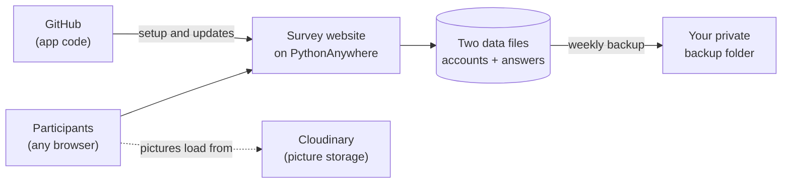

# Running the survey website

This guide is for the person who looks after the live survey website. You don't need to
know how the app works inside. Each step tells you what to click or what to copy and paste.

The site runs for free on **PythonAnywhere**, a website host. Your jobs are:

| When | Job | Time |
|---|---|---|
| Once | Set up the website | about 30 min |
| Every 3 weeks | Click "extend" so the site keeps running | 2 min |
| Every week | Download a backup of the data | 5 min |
| When asked | Install an updated version | 10 min |

## How it fits together



- **The data files** hold participant accounts (email, name, age, gender, region) and
  every survey answer. Treat them as private.
- **The pictures** are stored on a separate service called Cloudinary. You don't manage
  them.

## Before you start

**Create a new, free PythonAnywhere account just for this survey.** Don't use a personal
account.

- Sign up at <https://www.pythonanywhere.com> and choose the free **Beginner** plan.
- **The username becomes the web address**: `https://USERNAME.pythonanywhere.com`. It
  can't be changed later, so pick something neutral, such as `templesurvey`.
- Sign up with a **shared lab email address** if you have one, so someone else can get in
  if you're away.

Throughout this guide, replace **`USERNAME`** with that username.

## One-time setup

### Step 1: Open a command window

In PythonAnywhere, open the **Consoles** tab and click **Bash**. A black command window
opens in your browser. Copy and paste the commands below into it, one box at a time, and
press Enter.

### Step 2: Download the app and its starter data

```sh
git clone -b develop https://github.com/HSTlabs/webapp_image_aesthetics_v2.git
cd webapp_image_aesthetics_v2
mkdir -p instance
cp -n seed/img_db img_db
cp -n seed/database.db instance/database.db
```

This downloads the app and creates the two data files with the picture list and no
participants yet. Running it again never overwrites existing data.

### Step 3: Install what the app needs

```sh
mkvirtualenv --python=python3.12 survey
pip install -r requirements.txt
```

This takes a few minutes. When it finishes, the prompt starts with `(survey)`.

### Step 4: Create the secret key

```sh
python -c "import secrets; print(secrets.token_hex(32))"
```

This prints a long random code. **Copy it somewhere private for the next few minutes.**
It works like a master password that protects everyone's logins:

- Never share it, email it or paste it into chat.
- Never change it after launch. Changing it logs everyone out. Only replace it if it
  leaks.

### Step 5: Create the website

1. Open the **Web** tab and click **Add a new web app**.
2. Click **Next**, choose **Manual configuration**, choose **Python 3.12** and click
   **Next**.

### Step 6: Fill in the settings on the Web tab

Scroll down the **Web** tab and fill in:

| Section | Field | Enter |
|---|---|---|
| Virtualenv | path | `/home/USERNAME/.virtualenvs/survey` |
| Static files | URL | `/static/` |
| Static files | Directory | `/home/USERNAME/webapp_image_aesthetics_v2/website/static` |
| Security | Force HTTPS | turn **on** |

### Step 7: Connect the website to the app

1. On the **Web** tab, under **Code**, click the link next to **WSGI configuration file**.
2. Delete everything in the file.
3. Paste this in, then replace `USERNAME` and `PASTE-THE-SECRET-KEY-HERE`:

   ```python
   import os, sys
   os.environ['SECRET_KEY'] = 'PASTE-THE-SECRET-KEY-HERE'
   path = '/home/USERNAME/webapp_image_aesthetics_v2'
   if path not in sys.path:
       sys.path.insert(0, path)
   from main import app as application
   ```

4. Click **Save**.

### Step 8: Start it and test it

1. Back on the **Web** tab, click the big green **Reload** button.
2. Open `https://USERNAME.pythonanywhere.com/sign-up`.
3. Create a test account and take one survey to the end.
4. Send the web address to the project owner.

## Every 3 weeks: keep the site running

The free plan **switches the website off after one month** unless someone clicks a button.
Nothing gets deleted, but participants can't reach the site until it's switched back on.

1. Log in to PythonAnywhere and open the **Web** tab.
2. Click the button that says **Run until 1 month from today** (the wording may differ
   slightly).

> **Set a repeating calendar reminder every 3 weeks**, and add the project owner to it.
> PythonAnywhere also emails a warning before the site switches off, but don't rely on it.

## Every week: back up the data

1. Open the **Files** tab and go to `webapp_image_aesthetics_v2`.
2. Download **`img_db`** (the download icon next to the file name).
3. Open the **`instance`** folder and download **`database.db`**.
4. Rename both with the date, e.g. `2026-10-14_img_db` and `2026-10-14_database.db`.
5. Save them in a **private** lab folder. They contain personal information, so never put
   them anywhere public.

Keep at least the last four weeks of backups.

## When asked to install an update

Back up the data first (see above), then in a **Bash** console:

```sh
cd ~/webapp_image_aesthetics_v2
git pull
workon survey
pip install -r requirements.txt
```

Then click **Reload** on the **Web** tab and take one test survey. Updates never touch the
two data files.

## If something goes wrong

| What you see | What to do |
|---|---|
| The site says it's disabled or expired | Extend it on the **Web** tab (see above) |
| An error page instead of the survey | **Web** tab → **Log files** → open the **error log** and send the last 30 lines to the project owner |
| Pictures don't appear | Tell the project owner; the pictures are stored elsewhere |
| A participant can't reset their password | Expected: password reset by email isn't set up yet. Tell the project owner |
| The command window says `command not found` | Check the command was copied exactly, then try again |

## Never do these

- Delete, rename or replace `img_db` or `instance/database.db` on the server.
- Share the secret key or the backup files.
- Change the secret key after launch, unless it has leaked.
- Delete the PythonAnywhere account or web app without asking the project owner.
